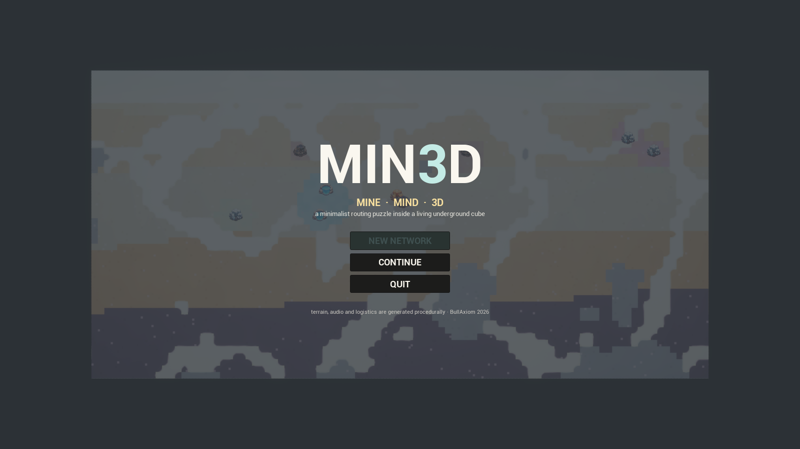
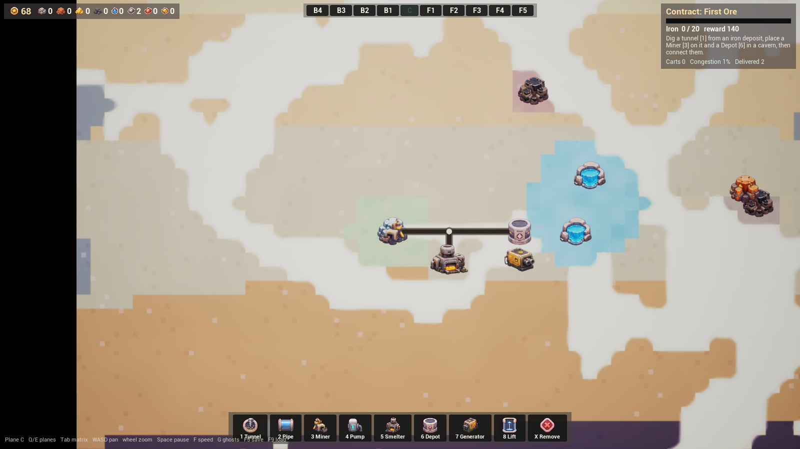
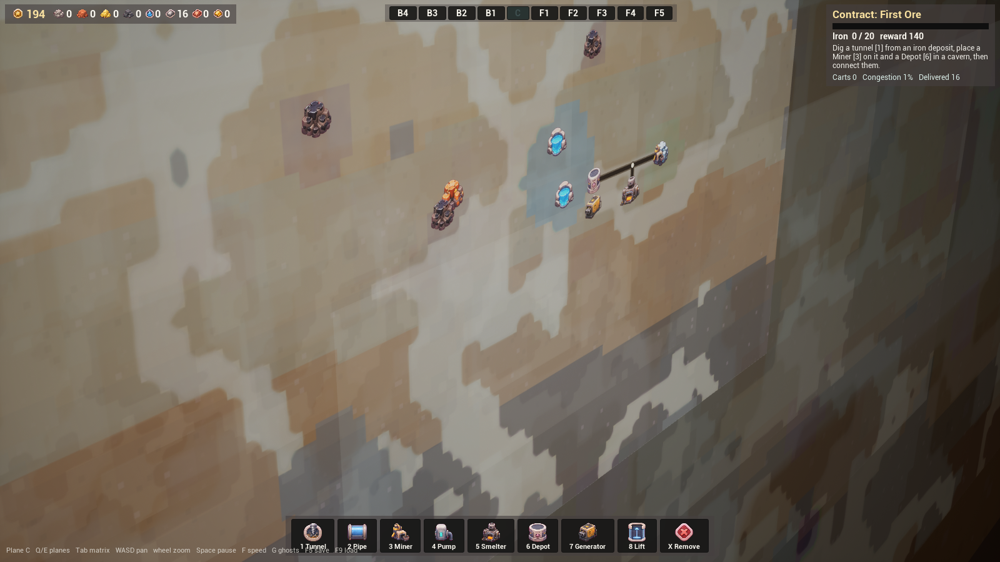

# MIN3D  —  Mine · Mind · 3D

*(the **3** is a backwards E — read it "Mined")*

A minimalist mining, logistics and route-optimization puzzle set inside a living
underground cube, built with **Unreal Engine 5.8** in pure C++ — no Blueprints,
and almost no content assets: the terrain, the audio and every mesh are
generated procedurally at runtime. The only authored art is a set of painterly
sprite sheets, chroma-keyed and sliced by `Tools/process_sprites.py`.



## The game

The world is a 96 × 48 × 10 lattice of pastel underground terrain: ten parallel
2D planes (B4…B1, C, F1…F5) that you edit one readable slice at a time. Ore
deposits, aquifers, caverns and unbreakable granite are placed by a seeded
generator; geological bands warp gently with depth.

Your **Base** sits on the surface — every supply you mine must ultimately be
routed home to it. You dig tunnels **by clicking and dragging**, place miners on
deposits, pumps on aquifer springs, smelters, relay depots and coal-fired
generators, and connect planes with lifts. Carts flow along the route graph
automatically — A* with congestion and transfer penalties — and congested lanes
glow red and slow down. An interactive tutorial teaches the loop; contracts
then walk you from your first iron delivery to deep-plane gold logistics.



- **Tunnels flood in aquifers — pipes may cross them.** Granite cannot be dug.
- Smelters turn ore into ingots and dispatch them onward on their own; depots
  are relays that consolidate cargo and forward it home to the Base.
- Generators burn delivered coal and power nearby structures (the Base powers
  its surroundings for free); unpowered machines crawl at 35 % speed.
- Neighboring planes ghost through at 20 % / 8 % opacity; **Tab** opens a matrix
  overview of the whole cube.



## Controls

| Input | Action |
| --- | --- |
| **1 / 2** | dig tunnel / lay pipe (click-drag) |
| **3–7** | miner · pump · smelter · depot · generator |
| **8** | lift: click a cell, switch plane, click again |
| **X** | remove, **RMB / Esc** cancel |
| **Q / E** or **[ ]** | previous / next plane |
| **Tab** | matrix overview |
| **WASD / MMB-drag** | pan, **wheel** zoom |
| **Space** | pause, **F** sim speed, **G** toggle ghosts |
| **F5 / F9** | save / load |

## Building from source

Requirements: Unreal Engine 5.8, Visual Studio 2022 C++, Python 3 (Pillow +
numpy) for the one-time sprite slicing.

```powershell
# 1. slice the sprite sheets into Content/SpriteSrc (one-time)
python Tools/process_sprites.py

# 2. bootstrap the two parent materials + empty map (one-time)
& "<UE5.8>\Engine\Binaries\Win64\UnrealEditor-Cmd.exe" Min3D.uproject `
    -run=pythonscript -script="Tools/bootstrap_content.py" -unattended -nopause -nosplash

# 3. compile
& "<UE5.8>\Engine\Build\BatchFiles\Build.bat" Min3DEditor Win64 Development -project="<repo>\Min3D.uproject" -WaitMutex

# 4. play
& "<UE5.8>\Engine\Binaries\Win64\UnrealEditor.exe" "<repo>\Min3D.uproject" -game -windowed -resx=1600 -resy=900

# package Win64 Shipping
& "<UE5.8>\Engine\Build\BatchFiles\RunUAT.bat" BuildCookRun -project="<repo>\Min3D.uproject" `
    -noP4 -platform=Win64 -clientconfig=Shipping -build -cook -pak -iostore -stage `
    -archive -archivedirectory="<repo>\Packaged"
```

Headless smoke-test flags: `-MinAutoBuild` (assemble an iron chain), `-MinFast=3`
(sim speed), `-MinAutoShot=N` / `-MinAutoQuit=N` (screenshot / exit timers),
`-MinAutoPlane=N`, `-MinAutoMatrix=N`, `-MinAutoSave=N`, `-MinLoad`,
`-MinSkipTitle`, `-MinSeed=12345`.

## Architecture (Source/Min3D)

| File | Role |
| --- | --- |
| `MinTypes.h` | grid constants, cells, graph, cart & contract structs |
| `MinWorld` | deterministic FBM terrain gen, deposits, excavation (sim only) |
| `MinAssets` | runtime sprite loader (PNG → UTexture2D), shared quad mesh, MID factory |
| `MinSim` | route graph, A*, congestion, structures, carts, power, contracts, JSON save |
| `MinPlaneActor` | per-plane render: procedural pastel terrain texture, route meshes, sprites, cart pool |
| `MinAudio` | one procedural stereo stream: synth SFX, cave ambience, generative pentatonic pad |
| `MinPawn / MinPlayerController` | ortho plane camera, matrix orbit, drag-to-dig tools |
| `MinHUD` | all UI in C++ Slate: resource bar, plane tabs, toolbar, contracts, title |
| `MinGameMode` | orchestration, ghost-plane opacity, smoke-test hooks |

Simulation and rendering are strictly separated: `MinWorld`/`MinSim` never touch
components; `MinPlaneActor` renders whatever the sim says.

## Credits

Design guide + sprite sheets provided by BullAxiom. Everything else —
terrain, meshes, UI, sounds, music — is generated by code at runtime.
Built with Claude Code.
